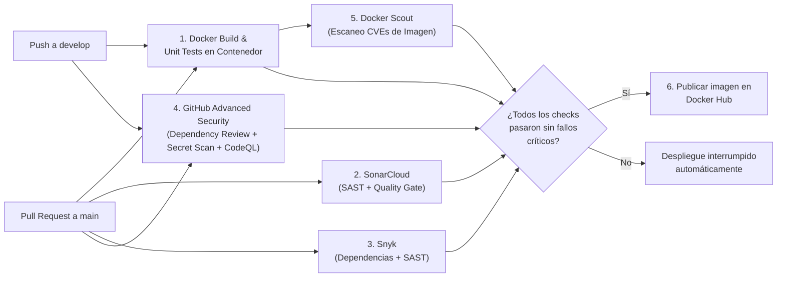
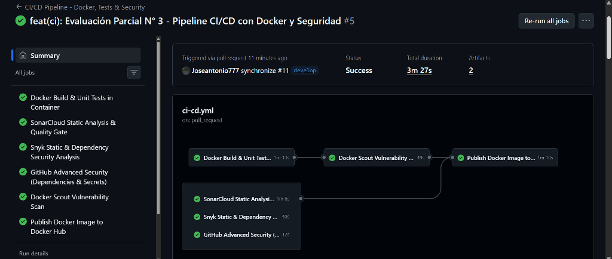
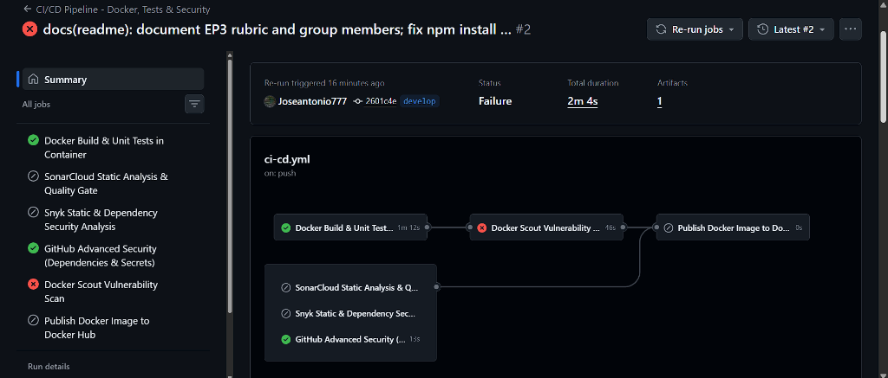
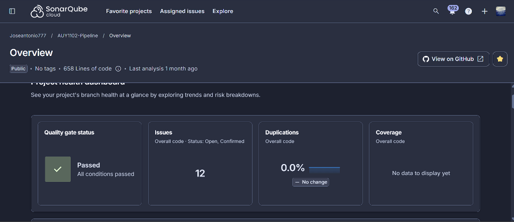
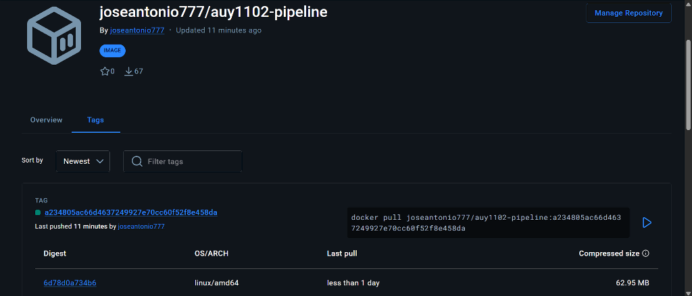

# AUY1102 - Evaluación Parcial N° 3: Aseguramiento de la Calidad del Software con GitHub y GitHub Actions

**Asignatura:** AUY1102 - Ciclo de Vida del Software I  
**Docente:** Valeria Muñoz (`@vmunozvaleria`)  
**Integrantes:** José Villarroel · Fernando Galdamez  
**Repositorio público:** https://github.com/2026-2-AV-AUY1102-Grupo-2/AUY1102-Pipeline-EV3  
**Fork basado en:** `Fundacion-Instituto-Profesional-Duoc-UC/AUY1102-Pipeline`

> La documentación original del proyecto base (inglés) se conserva en [docs/README.en.md](docs/README.en.md) y las evidencias de la Evaluación 2 en [docs/evidencias/README.md](docs/evidencias/README.md).

---

## 1. Objetivo y Alineamiento con la Rúbrica

Este repositorio implementa un pipeline completo de **Integración y Entrega Continua (CI/CD)** con controles automatizados de **construcción en contenedores, pruebas unitarias, análisis estático de código y seguridad**, cubriendo los tres indicadores de logro de la evaluación:

| Indicador | Descripción | Cómo se evidencia en este repositorio |
|---|---|---|
| **IE4.1.1 (33%)** | Reconoce componentes de CI/CD, manteniendo la integridad del código y respetando consideraciones éticas para automatizar procesos y reducir intervención manual. | Uso estricto de GitHub Secrets (cero credenciales en código), saneamiento de tokens expuestos, principio de mínimo privilegio en workflows (`permissions: contents: read`), contenedor con usuario no-root (`USER node`) y automatización de validaciones. |
| **IE4.2.1 (33%)** | Diseña pipelines de CI/CD garantizando la calidad y entrega continua del producto en un contexto de desarrollo ágil. | Flujo de ramas `develop` → `main` con disparadores en `push` a `develop` y `pull_request` a `main`, arquitectura de jobs encadenados con compuertas de calidad y seguridad (*Quality & Security Gates*) que impiden desplegar ante fallos críticos. |
| **IE4.3.1 (34%)** | Implementa pipelines de CI/CD para automatizar compilación, prueba y despliegue garantizando calidad y entrega continua. | `Dockerfile` multi-stage (`node:22-alpine`), pruebas unitarias ejecutadas **dentro del contenedor**, integración en GitHub Actions de **SonarCloud**, **Snyk**, **GitHub Advanced Security** (CodeQL, Dependency Review, Dependabot y Secret Scanning / Gitleaks), **Docker Scout** y publicación condicionada en **Docker Hub**. |

---

## 2. Arquitectura del Pipeline CI/CD

El pipeline está definido en [`.github/workflows/ci-cd.yml`](.github/workflows/ci-cd.yml) y complementado por [`.github/workflows/codeql.yml`](.github/workflows/codeql.yml) y [`.github/dependabot.yml`](.github/dependabot.yml).



---

## 3. Requerimientos Implementados

### Parte 1: Automatización con GitHub Actions y Docker

- **Fork y visibilidad pública:** Fork creado desde `Fundacion-Instituto-Profesional-Duoc-UC/AUY1102-Pipeline` en repositorio público (`2026-2-AV-AUY1102-Grupo-2/AUY1102-Pipeline-EV3`).
- **Dockerización ([`Dockerfile`](Dockerfile) y [`.dockerignore`](.dockerignore)):**
  - Construcción **multi-stage** sobre `node:22-alpine`.
  - Etapa `builder`: instala dependencias, compila TypeScript (`npm run build`) y sirve para ejecutar la suite de pruebas unitarias dentro del contenedor.
  - Etapa `production`: imagen liviana con solo dependencias de producción (`--omit=dev`), artefactos compilados en `dist/` y ejecución con usuario sin privilegios (`USER node`).
- **Pruebas unitarias dentro del contenedor:** El job `docker-build-and-test` construye la etapa `builder` y ejecuta:
  ```bash
  docker run --rm auy1102-pipeline:test npm run test:unit
  ```
- **Publicación en Docker Hub:** El job `publish-dockerhub` autentica mediante `docker/login-action@v3` y publica la imagen con `docker/build-push-action@v6` (`latest` y tag por SHA del commit) **únicamente si las pruebas y todos los análisis de calidad y seguridad fueron exitosos**.
- **Disparadores configurados:**
  - `push` a la rama `develop`
  - `pull_request` hacia la rama `main`

### Parte 2: Análisis de Código y Seguridad

| Herramienta | Integración en el Pipeline | Cuándo corre | Criterio de bloqueo (*Gate*) |
|---|---|---|---|
| **SonarCloud** | `SonarSource/sonarqube-scan-action@v5` + [`sonar-project.properties`](sonar-project.properties) | En cada `pull_request` a `main` | `-Dsonar.qualitygate.wait=true` interrumpe el pipeline si no pasa el Quality Gate. |
| **Snyk** | CLI oficial (`snyk test` + `snyk code test`) | En cada `pull_request` a `main` | `--severity-threshold=critical` falla si detecta vulnerabilidades críticas en dependencias o código. |
| **GitHub Advanced Security** | `actions/dependency-review-action@v4`, `trufflesecurity/trufflehog@main`, [`codeql.yml`](.github/workflows/codeql.yml), [`dependabot.yml`](.github/dependabot.yml) y Secret Scanning / Push Protection | `push` a `develop` y `pull_request` a `main` | `fail-on-severity: critical` en Dependency Review y fallo automático ante secretos detectados. |
| **Docker Scout** | `docker/scout-action@v1` (`command: cves`) | Después de construir y probar la imagen | `only-severities: critical` y `exit-code: true` bloquean el despliegue si la imagen tiene CVEs críticos. |
| **Interrupción de despliegue** | `needs:` + `if: ${{ !failure() && !cancelled() }}` en `publish-dockerhub` | Siempre | Si cualquiera de los jobs previos falla, `publish-dockerhub` se omite (`skipped`) y la imagen no se publica. |

---

## 4. Secretos y Consideraciones Éticas (Integridad y Seguridad)

Ninguna credencial se almacena en el código fuente. Todas las autenticaciones se gestionan mediante **GitHub Actions Secrets** (*Settings → Secrets and variables → Actions*):

| Secret | Propósito |
|---|---|
| `DOCKERHUB_USERNAME` | Usuario de Docker Hub para publicar la imagen y autenticar Docker Scout. |
| `DOCKERHUB_TOKEN` | Personal Access Token de Docker Hub (permisos Read & Write). |
| `SONAR_TOKEN` | Token de autenticación contra SonarCloud (`joseantonio777`). |
| `SNYK_TOKEN` | API Token de Snyk para análisis de dependencias y SAST. |

Además, se eliminaron los tokens hardcodeados de ejemplo presentes en el repositorio original (`src/index.ts`, `credentials.yml`, `.npmrc`) y se restringieron los permisos de los workflows al mínimo necesario (`permissions: contents: read`).

---

## 5. Ejecución Local (Verificación)

### Con Node.js
```bash
git clone https://github.com/2026-2-AV-AUY1102-Grupo-2/AUY1102-Pipeline-EV3.git
cd AUY1102-Pipeline-EV3
npm install --ignore-scripts
npm run build
npm run test:unit
```

### Con Docker (pruebas dentro del contenedor)
```bash
# Construir imagen de pruebas y ejecutar unit tests dentro del contenedor
docker build --target builder -t auy1102-pipeline:test .
docker run --rm auy1102-pipeline:test npm run test:unit

# Construir imagen final de producción
docker build --target production -t auy1102-pipeline:prod .
```

---

## 6. Evidencias de Ejecución (Evaluación Parcial N° 3)

### 6.1 Pipeline completo en verde (`pull_request` a `main` — PR #11)
Ejecución exitosa de los 6 jobs: construcción de imagen Docker y pruebas unitarias dentro del contenedor, SonarCloud (Quality Gate), Snyk, GitHub Advanced Security (Dependency Review + Gitleaks), Docker Scout y publicación en Docker Hub.



### 6.2 Interrupción automática del despliegue ante vulnerabilidad crítica (Docker Scout)
Al detectar el CVE crítico `CVE-2026-4738` en `zlib` de la imagen base, **Docker Scout** marcó fallo y el job **Publish Docker Image to Docker Hub** quedó bloqueado automáticamente (`skipped`) hasta aplicar la remediación (`apk upgrade --no-cache`).



### 6.3 Análisis estático y Quality Gate en SonarCloud
Validación del proyecto `Joseantonio777_AUY1102-Pipeline` en SonarCloud con **Quality Gate: Passed** y `0.0%` de duplicaciones.



### 6.4 Imagen publicada automáticamente en Docker Hub
Publicación exitosa de `joseantonio777/auy1102-pipeline` en Docker Hub (`linux/amd64`, imagen de producción multi-stage de ~63 MB).



---

## 7. Historial de Remediaciones y Evidencias (EA2)

Las remediaciones previas de vulnerabilidades (eliminación de secretos expuestos, corrección de SSTI en `pug`, actualización de dependencias y habilitación del panel Security de GitHub) se documentan en [docs/evidencias/README.md](docs/evidencias/README.md).
